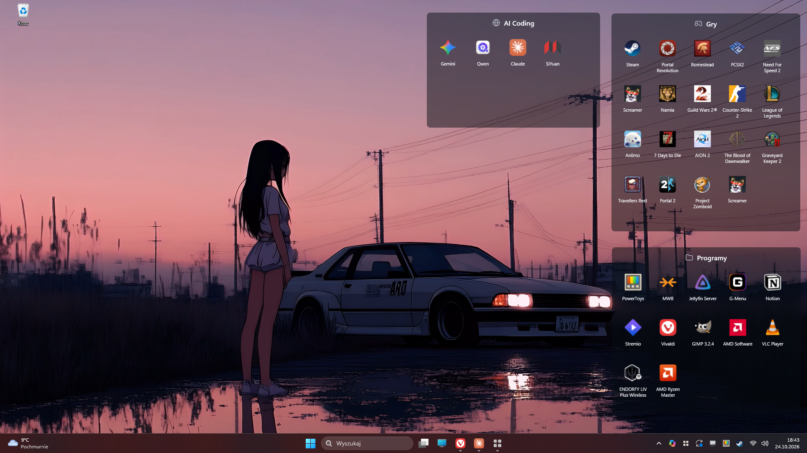
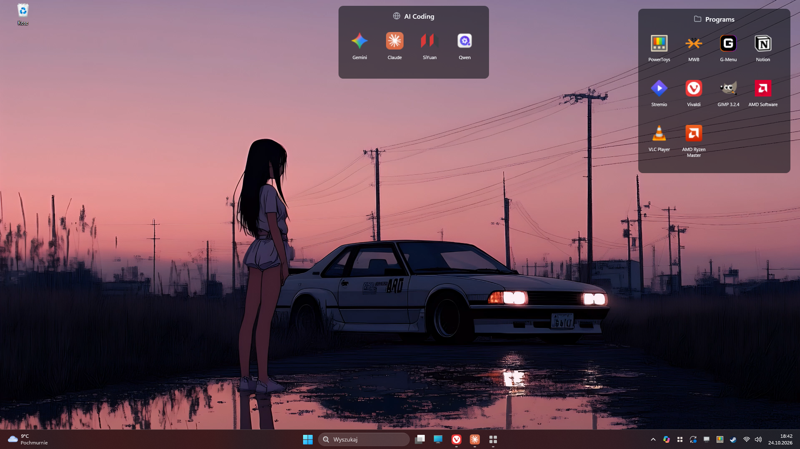
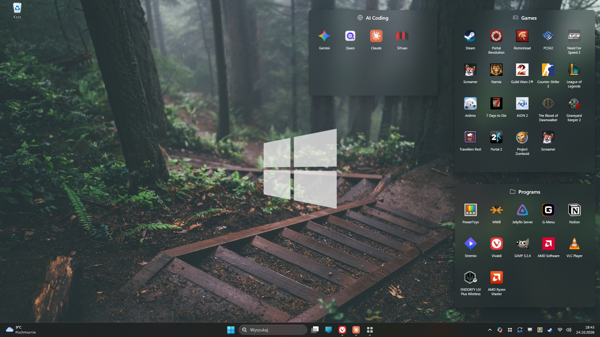
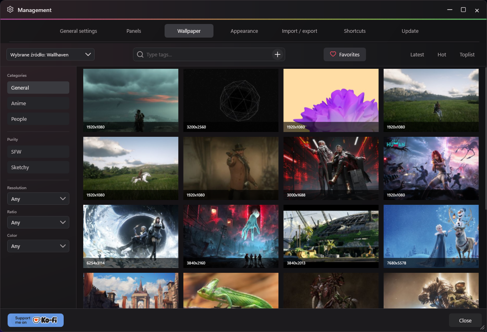
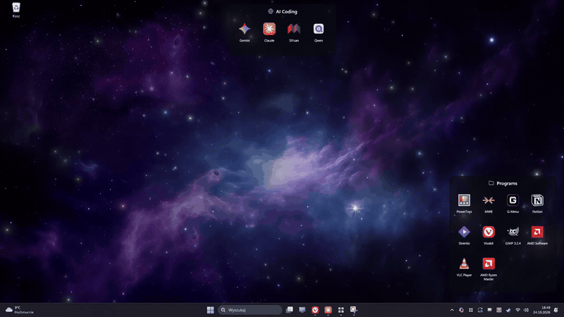

<div align="center">
  

  <h1>My Fancy Fences</h1>

  <p>
    
    
    
    
  </p>

  <p>
    <em>Desktop panels, shortcuts, layouts, and wallpapers in one clean Windows tool.</em><br />
    <strong>Organize faster. Switch layouts instantly. Bring your desktop to life.</strong>
  </p>
</div>

---

## 📸 Screenshots

### 🗂️ Layouts you can switch with a hotkey

Save as many layouts as you like and jump between them instantly. Here `Alt + H` shows the **Home** layout and `Alt + W` switches to **Work**.

> **Note:** `Alt + H` and `Alt + W` are only examples. No hotkeys are set by default — assign your own for each layout in the **Shortcuts** tab of the management window.

| Home (`Alt + H`) | Work (`Alt + W`) |
| :---: | :---: |
|  |  |

### 🎨 Your panels, your style

Colors, transparency, rounded corners, blur, fonts, and icon size — change the look of every panel, together with the wallpaper.



### 🌄 Wallpaper browser

Browse, search, favorite, and set wallpapers without leaving the app.



### 🎞️ Live wallpapers

Animated wallpapers play right behind your panels.



## ✨ Features

- 🧩 Create clean desktop panels for apps, files, folders, and shortcuts
- 🖱️ Drag and drop items directly onto panels, rename them, or move them back to the desktop
- 🗂️ Save multiple desktop layouts and switch between them instantly
- ⌨️ Assign global hotkeys for layout switching
- 🖥️ Separate panel positions and sizes for single-monitor and multi-monitor setups, restored automatically when a monitor is connected or switched off
- 🎨 Customize colors, transparency, borders, corner radius, background blur, typography, and icon size
- 🔒 Lock all panels so nothing moves by accident
- 🌄 Browse, favorite, download, and set wallpapers inside the app
- 🎞️ Set static wallpapers and experimental live wallpapers
- 🔄 Update from inside the app: you are notified when a new version is available and can install it in one click
- 🚀 Optional startup with Windows, controlled from settings or the tray menu
- 📦 Use tray controls, import/export, and automatic backups
- 🌍 Available in 12 languages, using your Windows language by default

## 🖼️ Wallpaper Sources

My Fancy Fences can browse wallpapers from third-party sources:

- 🔵 [Wallhaven](https://wallhaven.cc/) — static wallpapers through the Wallhaven API.
- 🟢 [MotionBGs / MoeWalls](https://motionbgs.com/) — animated live wallpapers and previews.

Wallpapers remain the property of their original owners. My Fancy Fences does not include wallpaper files in the repository or release packages; it only helps users browse, preview, download, and apply wallpapers from supported sources.

## 🚀 Quick Start

### Install

1. Download the latest **Setup EXE** from the [Releases](https://github.com/infitis-studio/my-fancy-fences/releases/latest) page.
2. Run it. It installs for your user account, so no administrator prompt is needed.
3. If the Microsoft .NET 10 Desktop Runtime is missing, Setup downloads it for you.

On the first launch the app pins its tray icon and shows a short hint about how to open the management window.

Requirements: Windows 10 or Windows 11.

### Build and run

```powershell
dotnet build "My Fancy Fences.slnx"
dotnet run --project "My Fancy Fences/My Fancy Fences.csproj"
```

## 🧭 Usage

- Double-click a panel header to edit that panel.
- Right-click an icon to rename it, move it to the desktop, or remove it from the panel.
- Click the empty-panel prompt or drag files/apps/shortcuts onto a panel to create shortcuts.
- Choose single-click or double-click activation for panel items.
- Use the management window to edit panels and layouts, browse wallpapers, change the shared appearance, and import/export settings.
- Double-click the tray icon to open the management window.
- Right-click the tray icon to open settings, add a panel, lock all panels, toggle startup with Windows, or close the application.

## 🛠️ Built With

- WPF and .NET 10
- [MahApps.Metro.IconPacks.Lucide](https://github.com/MahApps/MahApps.Metro.IconPacks)
- [Wallhaven API](https://wallhaven.cc/help/api)
- [MotionBGs / MoeWalls](https://motionbgs.com/)

## 🧪 Project Status

My Fancy Fences is under active development and may still contain bugs. Features and saved-settings formats may change between versions.

## ☕ Support

If the app is useful to you, you can support a small independent developer on [Ko-fi](https://ko-fi.com/infitisstudio).

## 🤝 Contributing

Issues, suggestions, and pull requests are welcome.

## 📄 License

My Fancy Fences is available under the [MIT License](LICENSE).
